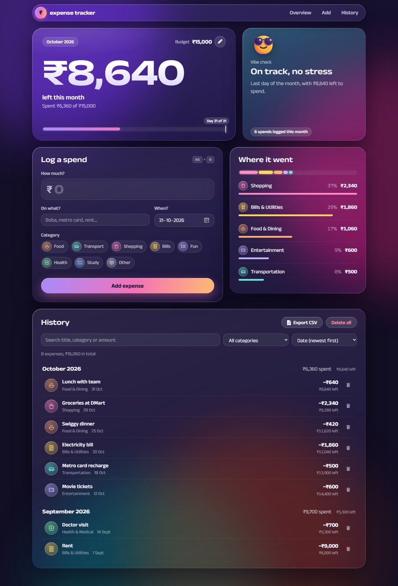
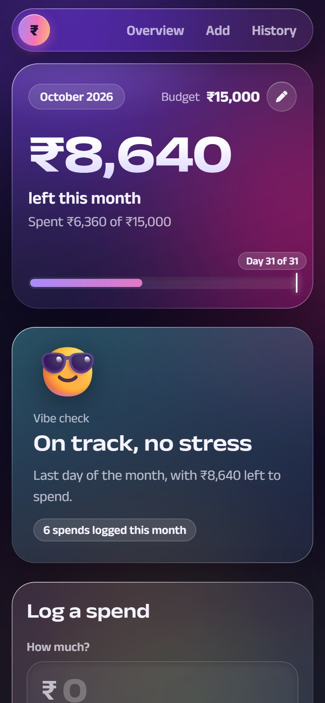

# 💰 Personal Expense Tracker

A responsive web app for tracking personal expenses against a monthly budget. Built with vanilla HTML, CSS, and JavaScript, it also serves as a small, practical showcase of searching, filtering and sorting algorithms.

🌐 **Live Demo**: [View Live Site](https://devKiNGCRiC.github.io/expense-tracker)

<p align="center">
  
  &nbsp;
  
</p>

## ✨ Features

### 💸 Expense Management
- **Add Expenses**: Record daily expenses with title, amount, a one-tap category chip, and date
- **Monthly Budget**: See how much is left this month; past months don't count against it. Edit it right in the overview
- **Pace Meter**: Compares budget used with how far through the month you are
- **Vibe Check**: A card that reacts to your pace (😎 on track, 👀 spending fast, 💀 over budget) with a daily allowance
- **History**: Expenses in date order, grouped by month with a subtotal for each and a running balance against the budget
- **Category Breakdown**: This month's spending per category, with one strip showing how much of the budget each category took
- **Budget Alerts**: A notice when spending crosses 50%, 80% and 100% of the budget
- **Undo Delete**: Deleted expenses can be restored from the notification
- **Data Persistence**: Automatic saving with localStorage
- **CSV Export**: Download all expenses as a spreadsheet-friendly CSV file

### 🔍 Search & Filter
- **Linear Search Algorithm**: Real-time search across titles, categories, and amounts
- **Category Filtering**: Filter expenses by specific categories
- **Combined Operations**: Search + Filter + Sort working together

### 📊 Smart Sorting (DSA Implementation)
- **Multi-Level Sorting**: Primary and secondary sort criteria
- **Date & Time Sorting**: Precise ordering using timestamps
- **Multiple Sort Options**:
  - 📅 Date & Time (Newest/Oldest First, the default is newest)
  - 💰 Amount (Highest/Lowest First)
  - 📂 Category (A-Z)
  - 📝 Title (A-Z)

### 🎨 Design
Liquid glass: frosted panels with light-catching rims float over slowly drifting colour glows.
- **Money left**: what's left this month in large type, with a glowing meter and a pin for today
- **Vibe check**: a glass card tinted by your spending pace
- **Category colours**: each category has its own colour and line icon, shared by the chips, the breakdown and the history
- **Type**: [Anek Latin](https://fonts.google.com/specimen/Anek+Latin) throughout, set wide for the big numbers

### 🧭 UI/UX
- **Responsive Design**: Works on desktop, tablet, and mobile
- **Clear Feedback**: Short notifications, highlighted invalid fields, and distinct empty states
- **Accessible**: Keyboard-friendly controls, screen-reader labels and reduced-motion support

### ⌨️ Keyboard Shortcuts
- **Alt + N**: Jump to the "Add Expense" form

## 🧠 Data Structures & Algorithms

This project demonstrates several important DSA concepts:

### 📊 Data Structures Used
- **Arrays**: Dynamic storage of expense records
- **Objects/Hash Maps**: Efficient expense data structuring
- **Associative Arrays**: Category-to-name mapping

### 🔍 Algorithms Implemented

#### 1. Linear Search Algorithm
```javascript
// O(n) time complexity
function linearSearchExpenses(expensesArray, searchQuery) {
    // Multi-field search implementation
    // Searches across title, category, and amount
}
```
- **Time Complexity**: O(n)
- **Features**: Case-insensitive, multi-field search

#### 2. Multi-Level Sorting Algorithm
```javascript
// Primary sort by date, secondary sort by timestamp
expensesArray.sort((a, b) => {
    if (dateA.getTime() !== dateB.getTime()) {
        return dateB - dateA; // Primary criteria
    }
    return new Date(b.timestamp) - new Date(a.timestamp); // Secondary criteria
});
```
- **Time Complexity**: O(n log n)
- **Type**: Comparison-based stable sorting

#### 3. Filtering Algorithms
- **Array Filtering**: O(n) predicate-based filtering
- **Algorithm Chaining**: Search → Filter → Sort pipeline

### ⚡ Algorithm Complexity Analysis

| Operation | Time Complexity | Space Complexity |
|-----------|----------------|------------------|
| Add Expense | O(n) (`unshift` shifts existing items) | O(1) |
| Search | O(n) | O(k) |
| Sort | O(n log n) | O(n) (sorts a filtered copy) |
| Filter | O(n) | O(k) |
| Delete | O(n) | O(1) |

## 🚀 Technologies Used

- **HTML5**: Semantic structure with labelled form controls
- **CSS3**: Grid and Flexbox layout, `backdrop-filter` glass, and animations
- **Vanilla JavaScript**: Pure JS implementation (no frameworks)
- **LocalStorage API**: Client-side data persistence
- **Responsive Design**: Media queries for tablet and phone widths

## 📁 Project Structure

```
expense-tracker/
├── index.html          # Main HTML structure
├── style.css           # Responsive CSS styling
├── script.js           # JavaScript logic & DSA implementations
├── screenshots/        # App screenshots used in this README
├── LICENSE             # MIT License
└── README.md           # Project documentation
```

## 🔧 Installation & Usage

### Local Development
1. **Clone the repository**:
   ```bash
   git clone https://github.com/devKiNGCRiC/expense-tracker.git
   cd expense-tracker
   ```

2. **Open in browser**:
   - Double-click `index.html`, or
   - Use a local server (recommended):
     ```bash
     # Using Python
     python -m http.server 8000
     
     # Using Node.js (http-server)
     npx http-server
     ```

3. **Start tracking expenses**:
   - Add daily expenses
   - Set a monthly budget (optional)
   - Use search and filter features
   - Explore different sorting options

### Features to Try
- Add multiple expenses on the same date to see timestamp-based sorting
- Search for expenses using partial text (e.g., "foo" finds "food")
- Combine search + category filter + sorting
- Test responsive design on different screen sizes
- Export your expenses to CSV and open them in Excel or Google Sheets

## 💡 Learning Outcomes

This project demonstrates:
- **Practical DSA Application**: Real-world use of algorithms
- **Algorithm Integration**: Combining multiple algorithms effectively
- **Modern Web Development**: Responsive, accessible design
- **Code Organization**: Clean, maintainable JavaScript

## 🎯 DSA Concepts Covered

### Beginner Level
- Array operations and manipulation
- Object property access and iteration
- Basic sorting and searching

### Intermediate Level
- Multi-criteria sorting algorithms
- Algorithm chaining and composition
- Time/space complexity analysis
- Substring matching with `String.prototype.includes`

### Advanced Concepts
- Stable multi-key sorting with the built-in `Array.prototype.sort` (stable since ES2019)
- Data persistence patterns

## 🤝 Contributing

Contributions are welcome! Feel free to:
- Report bugs
- Suggest new features
- Improve DSA implementations
- Enhance UI/UX design

## 📄 License

This project is open source and available under the [MIT License](LICENSE).

## 👨‍💻 Developer

**devKiNGCRiC**
- GitHub: [@devKiNGCRiC](https://github.com/devKiNGCRiC)
- Project Link: [Expense Tracker](https://github.com/devKiNGCRiC/expense-tracker)

---

⭐ **Star this repository if you found it helpful!**

Built with ❤️ and lots of ☕ by devKiNGCRiC